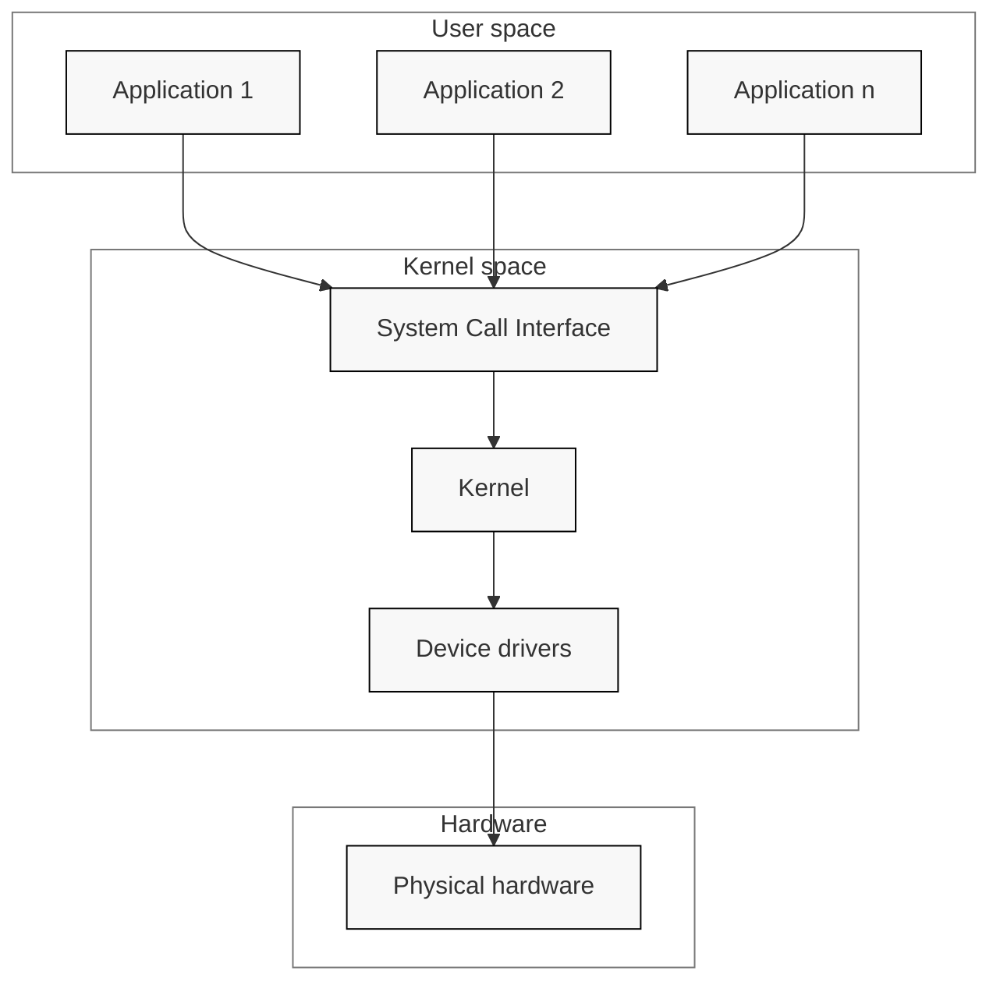

# OS Intro
  - Kernel Mode (priviledged) vs User Mode
  - *Code run in Kernel mode have complete, unrestricted access to the underlying hardware*
  - **Kernel Space**: memory area reserved to kernel processes

## Typical OS architecture

  - Kernel offers a set of APIs(System Calls) that application can use 
  - Core kernel code: generic (can be divided into logical subsystems which responsible for managing a specific set of OS services)
  - Device drivers: responsible of accessing particular devices

## Monolithic kernel
  - No access protection between various kernel subsystems
    - Any subssytem can directly access the internal datastructure, variables and functions of any other subsystem
  - Enforce a logical separation between subsystems (API is used to access service offered by 1 subsystems or device driver)

## Micro Kernel
  - Large parts of kernel are protected from each other (running as services in user space)
    - Since large parts of kernel running in user mode, remaining code runs in kernel mode is smaller (micro)
    - Kernel contain just enough code that allows for message passing between different runnign process (IPC + Memory management to setup protection between application and service)
    - Since services are isolated, bugs in 1 service won't impact other services
    - This architecture offers memory protection but at a cost of performance 
      - Application issues an IPC system call (CPU switch from user mode -> kernel mode (context switch), save application's current CPU registers into a kernel-managed data structure)
      - Microkernel (kernel space) inspects the message's destination. Copies message payload from applications memory buffer into the kernel's internal buffer, figure out which user-space thread should receive it
      - *Address Space Switch*: kernel must change CPU's memory management registers to point to the File Server's page tables (each process has its own virtual address space/private page table, in this case Process A(application) Process B(file server))
      - Microkernel restores the saved CPU registers for File Server
      - If file system needs to talk to disk driver, it requires another IPC message and context switch to driver process (still in user space)
      - Finally, the driver(disk) touches the physical hardware register

## Address Space
  - **Physical Address Space**: hardware-level layout of memory (each physical Byte is assigned a number called physical address)
  - **Virtual Address Space**: what individual processes and kernel see
    - Kernel sets up the mapping from virtual address space to physical memory areas (MMU translation)
    - Shared between **process (address) space** and **kernel (address) space**
    - User and Kernel share virtual address space (kernel creates a mapping that prevent access from user mode)
      - A portion of same virtual address space (created when running a program) is systematically reserved for the kernel
      - Every individual process's page table contains 2 distinct zones: Lower zone(User Space - unique to that specific process), Upper Zone (Kernel Space - identical across every single process on the system)(kernel enforces protection bits on Kernel space page table entries)

## Execution Context
  - Defines environment, priviledges, and states in which a piece of code runs
  - **process context**: environment when the CPU is executing on behalf of a specific process
    - Can run in kernel mode (applications makes System Call) or user mode (when executing application code)
    - Can use sleeping locks (if resource is locked, the task yields the CPU, goes to sleep(can safely wait for I/O operations to complete) and wake up when resource is free)
  - **interrupt context**: Specialized, high-priority execution environment triggered asynchronously by hardware or software interrupts
    - Code in interrupt context always runs in kernel mode with full hardware priviledge
    - (since interrupt must be serviced efficiently to keep system responsive) Cannot call functions that put execution threads to sleep
    - Since interrupt handler is not associated with a schedulable task, if it tries to sleep, kernel has no process to switch away
    - No user space access since it is not tied to any user process

## Multi-tasking (User Mode Preemption)
  - Done by quickly switching between running processes
  - Preemptive multitasking the kernel will enforce strict limits for each process (all have a fair share of CPU time)

## Preemptive Kernel (Kernel Mode Preemption)
  - (for code running in kernel)kernel itself can be interrupted and paused while running inside kernel mode so a higher-priority task can take over CPU
  - *Non-preemptive kernel can also support preemptive multitasking*
  - making kernel preemptive reduces latency (system more responsive)

## Pageable Kernel Memory
  - parts of kernel memory can be swapped to disk
  - **Paging**(memory management): allows physical address space of a process to be scattered across different, non-contiguous physical memory frames (divide virtual address space into fixed-sizse blocks called pages)

## Kernel Stack
  - Used to maintain the function call chain and local variables state while it is executing in kernel mode (from a system call)

## Portabilty
  - **Architecture and Machine Specific Code**: in C and Assembly
  - **Independent Architecture Code**: in C 
    1. Kernel core (further split in multiple subsystems)
    2. Device Drivers

## Asymmetric MultiProcessing (ASMP)
  - A way of supporting multiple processors(cores) by a kernel
  - 1 processor is dedicated to the kernel, other processors run user space programs
  - Disadvantage: Kernel throughput & Scalability

## Symmetric MultiProcessing (SMP)
  - Kernel can run on any of the existing processor (difficult to implement (needs to prevent race condition))
  - In order to support SMP, kernel must implement synchronization primitives to guarantee only 1 processor is executig a critical section

# Linux Kernel

## Source Code Layout
1. **arch**: architecture specific code; each architecture is implemented in a specific sub-folder
  - Interfacing with the boot loader and architecture specific initialization
  - Access to various hardware bits that are architecture or machine specific such as interrupt controller, SMP controller, BUS controllers, exceptions and interrupt setup, virtual memory handling
2. **block**: the block subsystem code that deals with reading and writing data from block devices (creating block I/O requests, merging requests)
3. **certs**: implement support for signature checking using certificates
4. **crypto**: software implementation of various cryptography algorithms as well as framework that allows offloading such algorithms in hardware
5. **Documentation**: documentatton for various subsystems, Linux kernel command line options, description for sysfs files and format, device tree binding
6. **drivers**: driver for various devices as well as the Linux driver model implementation (an abstraction that describes drivers, devices buses and the connection)
7. **firmware**: binary or hex files that are used by device drives
8. **fs**: home of the Virtual Filesystem Switch (generic filesystem code) and of various filesystem drivers
9. **include**: header files
10. **init**: generic initialization code that runs during boot
11. **ipc**: implementation of various Inter Process Communication system calls (message queue, semaphores, shared memory)
12. **kernel**: proces management code (support for kernel thread, workqueues), scheduler, tracing, time management, generic irq code, locking
13. **lib**: various generic functions such as sorting, checksums, compressoin and decompression, bitmap manipulation
14. **mm**: memory management code, for both physical and virtual memory, include the page, CMA allocator, swapping, virtual memory mapping, process address space manipulation
15. **net**: implementation for various network stacks including IPv4, IPv6; BSD socket implementation, routing, filtering, packet scheduling, bridging
16. **samples**: various driver samples
17. **scripts**: parts the build system, script used for building modules, kconfig the Linux kernel configurator
18. **security**: home of Linux Security Module framework that allows extending the default (Unix) security model as well as implementation for multiple such extensions such as SELinux, smack
19. **sound**: home of Advanced Linux Sound System 
20. **tools**: various user space tools for testing or interacting with Linux kernel subsystems
21. **usr**; support for embedding an initrd file in kernel image
22. **virt**: home of the KVM (Kernel Virtual Machine) hypervisor

## Linux Kernel Architecture
1. **arch**:
  - part of Linux Kernel which contains architecture specific code and may be further subdivided in machien specific code for certain architecture (arm)
  - It implements access to various hardware bits that are architecture or machine specific
  - Also implement architecture optimized functions
2. **Device drivers**:
  - Linux kernel uses a unified device model (purpose to maintain internal data structures that reflect the state and structure of the system - the information is essential for implementing system wide power management, device discovery and dynamic device removal)
  - Each subsystem has its own specific driver interface 
3. **Process Management**:
  - Linux implement standard Unix process management APIs such as `fork()`, `exec()`, `wait()` and POSIX threads
  - (Linux)No internal structures implementing processes or threads, instead, `struct task_struct` that describe an abstract scheduling unit called task
    - Task has pointers to resources (address space, file descriptor, IPC ids)
    - Resource pointers for tasks that are part of the same process point to the same resources
      - This peculiarity together with `clone()` and `unshare()`
  4. **Memory Management**
    - Management of physical memory (allocating and freeing memory)
    - Management of the virtual memory (paging, swapping, demand paging, copy on write)
    - User services (user address space management, mmap(), brk())
  5. **Block I/O management**
    - reading and writing data from or to block devices: create block I/O requests, transforming block I/O requests, merging and sorting the requests and scheduling them via various I/O schedulers to the block device drivers
    1. VFS(entry point for I/O operation): VFS handles generic filesystem operations and tranlates them into standard block-level operations
    2. Device Mapper(logical volume and abstraction layer): handles tasks (sotware RAID, encryption, logical volume management). 
      - Intercepts block I/O requests and transform them by mapping?
    3. Generic Block Layer(Core request management and structuring): Creating actual block I/O requests, merging adjacent requests to optimize throughput, and sorting
    4. I/O Scheduler(Request queuing and optimization): 
  6. **Virtual Filesystem Switch (VFS)**
    - implement common/generic filesystem code to reduce duplication in filesystem drivers
    - Contains filesystem abstraction such as:
      1. `inode`: describe file on disk (attributes, location of data blocks on disk)
      2. `dentry`: links an inode to a name
      3. `file`: describe the properties of an opened file(file pointer)
      4. `superblock`: describes the properties of a formatted filesystem
    - Linux VFS also implement caching:
      1. inode cache: caches the file attributes and internal file metadata
      2. dentry cache: caches the directory hierarchy of a filesystem
      3. page cache: caches file data blocks in memory