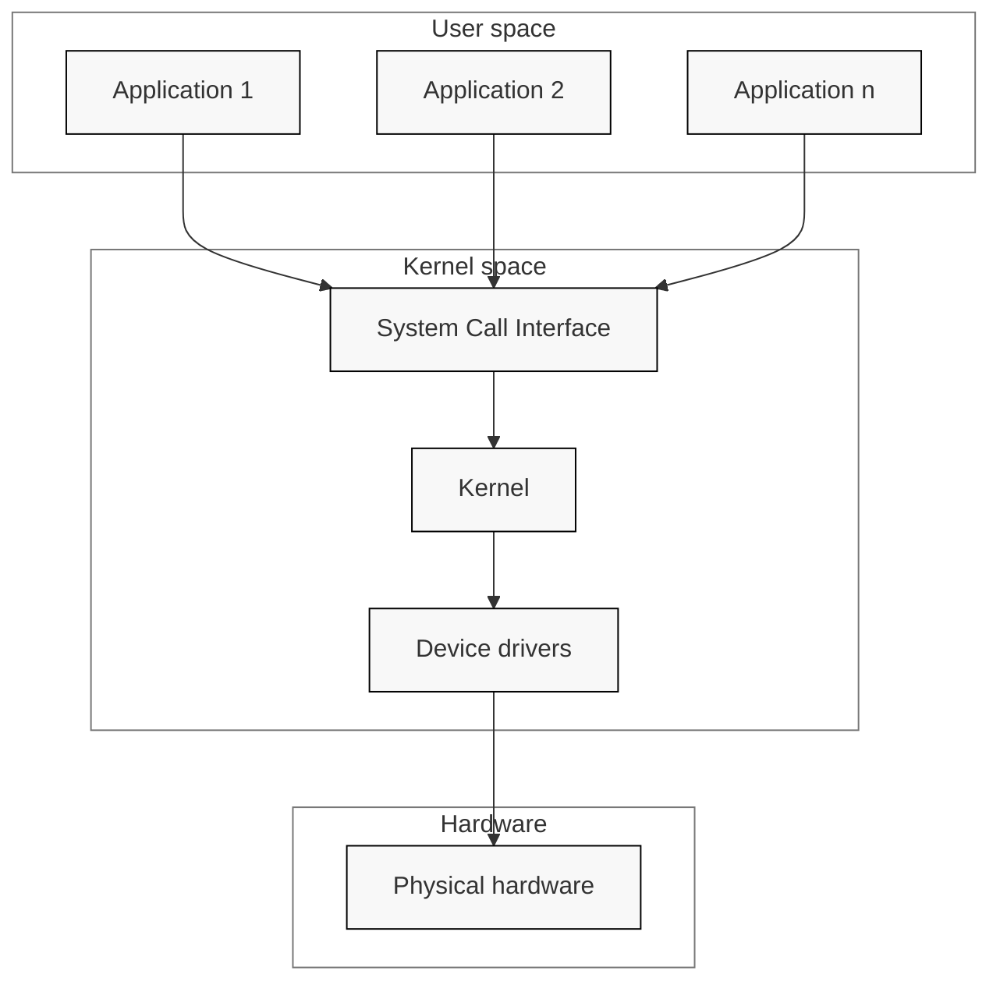

# OS Intro
  - Kernel Mode (priviledged) vs User Mode
  - *Code run in Kernel mode have complete, unrestricted access to the underlying hardware*
  - **Kernel Space**: memory area reserved to kernel processes
## Typical OS architecture

